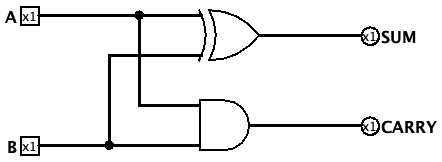

# Half Adder

## Goal

Build a circuit that adds two one-bit inputs, `A` and `B` and produce two
outputs:

- `SUM`: the low bit of the result
- `CARRY`: the bit that carries into the next position

Here's a truth table describing the circuit.

## Truth Table

| A | B | SUM | CARRY |
|---|---|-----|-------|
| 0 | 0 |  0  |   0   |
| 0 | 1 |  1  |   0   |
| 1 | 0 |  1  |   0   |
| 1 | 1 |  0  |   1   |

As we can see from the table, `SUM` is HIGH when exactly one input is HIGH. `CARRY` is HIGH only when both inputs are HIGH.

## Boolean Derivation

### SUM

The SUM output is HIGH for the rows `A=0, B=1` and `A=1, B=0`.

For the first row, `NOT A AND B` is HIGH. For the second row, `A AND NOT B`
is HIGH. Combining those two cases gives:

```text
SUM = (A AND NOT B) OR (NOT A AND B)
```

This is the Boolean definition of XOR:

```text
SUM = A XOR B
```

### CARRY

The CARRY output is HIGH only for the row where both inputs are HIGH. That is
exactly the behavior of an AND gate:

```text
CARRY = A AND B
```

## Circuit
Using
```text
SUM = A XOR B
CARRY = A AND B
```
we can now build the circuit for a half adder



## Test


| A | B | Expected SUM | Expected CARRY | Observed SUM | Observed CARRY |
|---|---|--------------|----------------|--------------|----------------|
| 0 | 0 |      0       |       0        |      0       |       0        |
| 0 | 1 |      1       |       0        |      1       |       0        |
| 1 | 0 |      1       |       0        |      1       |       0        |
| 1 | 1 |      0       |       1        |      0       |       1        |

## What We Learned

- Using a truth table we can dervie the cannonical representation of a logic gate and from that we can build the circuit.
- XOR describes the SUM bit because it is HIGH when exactly one input is HIGH.
- AND describes the CARRY bit because both inputs must be HIGH to produce a carry.